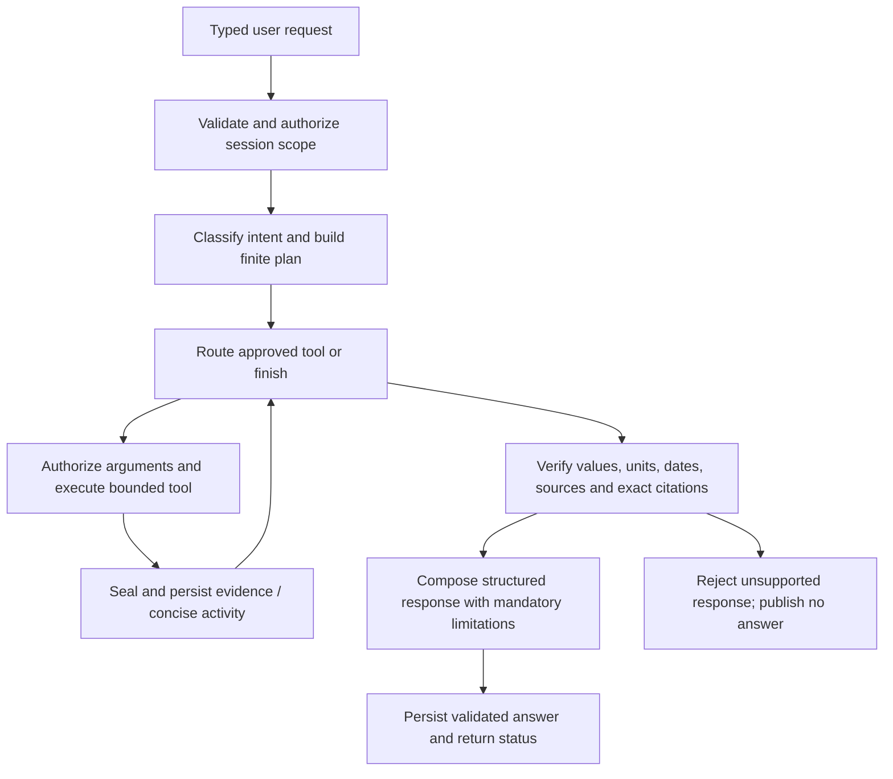

# Financial investigation architecture

Phase 4 extends the existing quantitative services. One investigator uses an explicit typed, testable state machine; no multi-agent orchestration or LangGraph dependency is necessary for this bounded workflow.

`app/agent/contracts.py` defines the request, workflow state, facts, citations and answer contracts. `service.py` enforces transitions, budgets, cancellation and owner scope. `tools.py`/`analytics.py` wrap existing Phase 1–3 services; `verification.py` verifies evidence and composes findings. `provider.py` is the provider-agnostic protocol plus an optional OpenAI Responses adapter. `documents` supplies page-aware retrieval and independent citation resolution. `evaluation.py` executes isolated synthetic regression workflows/probes.

## Provider and output boundary

Set backend-only `OPENAI_API_KEY` and `LLM_MODEL` (default configurable `gpt-4.1-mini`). The adapter uses hardcoded HTTPS OpenAI Responses, serial strict function calls and strict final JSON selection. The model chooses approved tools and copies fact references/values/units/dates or exact retrieved quotes. It cannot supply arbitrary final financial prose, arbitrary URLs, SQL, shell commands, document uploads/deletion, model governance or orders. Deterministic response composition supplies measured comparisons, source qualifications, extractive disclosure topics and reconciled scenario explanations. This conservative output contract favors auditable evidence over open-ended essays.

Only intent-appropriate tools are offered; backend checks the allowlist again. Server-resolved owner, source mode, captured portfolio and selected history/experiment/document scope are never controlled by model arguments. Risk confidence/window cannot silently differ from the user's controls; hypothetical shocks must be explicitly specified by the user or typed scenario. Model roles remain separate manual UI/API actions.

Live requests require `engine:llm` and `external_data_consent:true`. Only bounded redacted relevant facts/provenance and retrieved passages are transmitted, never broker credentials, raw price arrays, entire uploads or hidden instructions. Provider requests use `store:false`; this is not a claim about all provider retention policies. No raw provider prompts/responses or private chain-of-thought are stored or exposed. Successful usage tokens are recorded; cost estimates require explicit account-price settings and remain unavailable otherwise. Failed attempts may not provide billable usage, so this is not a billing ledger.

Without credentials, status explicitly says **AI provider not configured**. `engine:demo` runs a deterministic scripted plan against actual authorized tools and labels its answer accordingly. Other phases continue without an AI key. The application does not silently substitute a live AI run with a scripted answer.

Official contract references: [Responses function calling](https://developers.openai.com/api/docs/guides/function-calling), [structured outputs](https://developers.openai.com/api/docs/guides/structured-outputs), [embeddings](https://developers.openai.com/api/reference/resources/embeddings/methods/create).

## Execution and persistence

Defaults/maxima: eight tool calls, 24 graph transitions, 60-second total deadline (configurable 5–90 seconds), eight-second tool deadline, provider timeout 12 seconds (bounded 1–30). Provider transport retries at most once for transient failures, within the remaining request deadline. Maximum minimized context is 60,000 characters and cumulative available usage is capped at 64,000 tokens. Repeated calls/invalid responses consume budgets rather than creating an unbounded loop. Twelve investigations per minute per session and one active interactive investigator per process are permitted.

Workers and tools use separate SQLAlchemy sessions. A single helper slot prevents tool backlog. Cancellation stops subsequent calls and discards in-flight results; a bounded deterministic calculation or HTTP request may finish before cancellation is observed. In-flight risk calculations may have appended a saved audit run; no trading or financial-record editing occurs. Late results cannot become a cancelled answer. Running jobs from an absent process become interrupted when read; no automatic resume is claimed.

Migration 0004 adds investigations, ordered activity, sanitized tool calls, checksummed evidence and evaluation reports. Migration 0005 adds documents/chunks. Investigations capture a private immutable portfolio snapshot, original experiment/run references, provider/workflow version, actual usage where available, checks and final answer. Existing migrations/engines remain compatible. Model-comparison tools retain the selected experiment's original runtime, dataset hash, dates and source qualifications; the checked-in Phase 3 report is not relabeled or overwritten.

Opaque expiring browser sessions still define ownership. Restart/expiry loses identity and private records cannot be reassigned to new sessions. Use one backend process. Distributed jobs, durable identity, recovery, public deployment and operational retention belong to Phase 6.

## Complete example

1. Install locked dependencies and migrate to head; start backend and frontend as in README.
2. In Quantitative Research, execute a completed experiment in the current browser session.
3. Open AI Risk Assistant, select the experiment and a labeled execution mode. Ask the model-comparison example; inspect copied QLIKE, matched sample, original source/runtime, tail/regime warnings and saved tool activity.
4. Upload a permitted text PDF, inspect indexed status/pages, select it as context, then ask the document example. Inspect each exact cited passage or download the source.
5. Ask the sector-shock example. Technology P&L is calculated by the existing stress engine and contributions reconcile; it is explicitly hypothetical.
6. Run golden evaluation to inspect actual fixture results. This does not measure live-LLM quality.

For an actual paid-provider contract smoke, explicitly configure a key and run `VANTAGE_LIVE_AI=1 backend/.venv/bin/python backend/scripts/smoke_live_ai.py`. It uses only newly created synthetic evidence. This opt-in smoke is separate from CI and has not been run without credentials.
